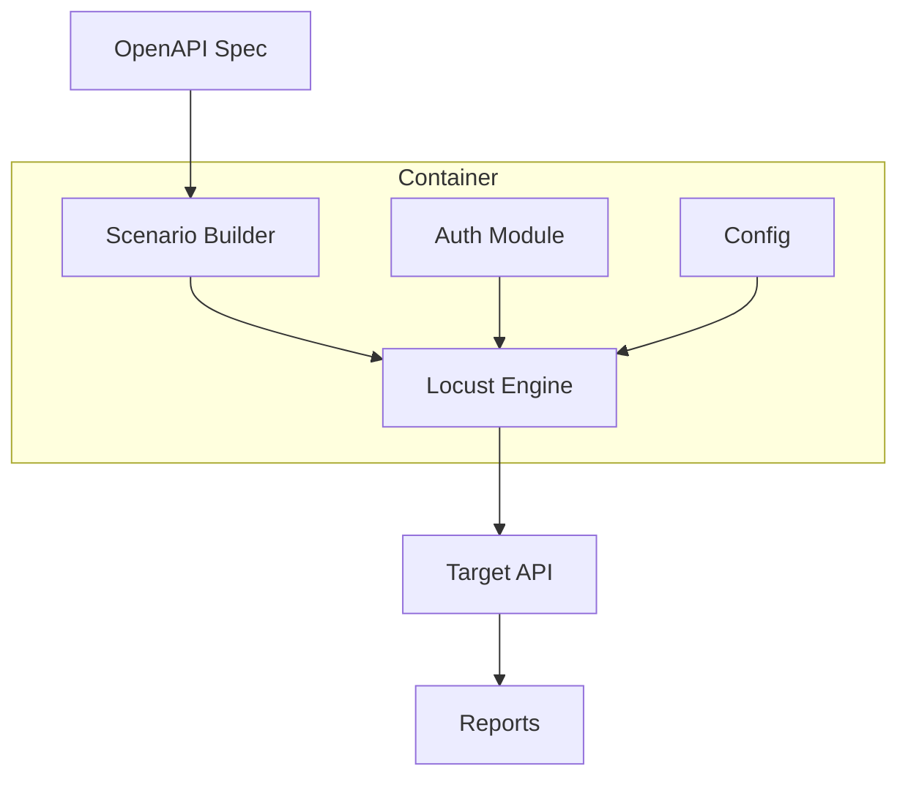

# Dynamic Stress Tests 🚀


> **Automated Load Testing Framework with Locust** - OpenAPI-driven dynamic stress tests that scale

## 🎯 Overview

This framework automatically generates comprehensive load tests from OpenAPI specifications, providing:

- **🔄 Dynamic Test Generation**: Auto-build requests from OpenAPI specs
- **🔐 Flexible Authentication**: Support JWT tokens or login flows
- **📊 Rich Reporting**: HTML, CSV, and JSON output formats
- **🐳 Container-Ready**: Docker + Compose for local dev and CI/CD
- **⚡ CI/CD Integration**: Ready for AWS pipelines and GitHub Actions
- **🎛️ Multiple Scenarios**: Ramp-up, spike, soak, and error testing

## 🏗️ Architecture



## 🚀 Quick Start

### Prerequisites

- Docker & Docker Compose
- OpenAPI specification (URL or local file)
- Target API endpoint

### 1. Setup

```bash
git clone https://github.com/arisecloudsolutions/dynamic-stress-tests.git
cd dynamic-stress-tests
cp .env.example .env
```

### 2. Configure Environment

Edit `.env` with your API details:

```env
OPENAPI_URL=https://your-api.com/openapi.json
BASE_URL=https://your-api.com
AUTH_MODE=login
LOGIN_URL=/auth/login
LOGIN_USER=testuser
LOGIN_PASS=testpass
MAX_USERS=100
```

### 3. Run Tests

**Web UI Mode (Development):**
```bash
docker compose up --build
# Open http://localhost:8089
```

**Headless Mode (CI/CD):**
```bash
RUN_TIME=10m MAX_USERS=50 docker compose run --rm locust
# Reports generated in ./reports/
```

## 📋 Configuration Reference

| Variable | Required | Example | Description |
|----------|----------|---------|-------------|
| `OPENAPI_URL` | ✅* | `https://api.example.com/openapi.json` | OpenAPI spec URL |
| `OPENAPI_PATH` | ✅* | `/specs/openapi.json` | Local OpenAPI file |
| `BASE_URL` | ✅ | `https://staging.example.com` | Target API base URL |
| `AUTH_MODE` | ❌ | `jwt` or `login` | Authentication method |
| `JWT_TOKEN` | ⚠️** | `eyJhbGci...` | Bearer token (if jwt mode) |
| `LOGIN_URL` | ⚠️*** | `/auth/login` | Login endpoint (if login mode) |
| `LOGIN_USER` | ⚠️*** | `user@example.com` | Username/email |
| `LOGIN_PASS` | ⚠️*** | `password123` | Password |
| `MAX_USERS` | ❌ | `100` | Maximum concurrent users |
| `SPAWN_RATE` | ❌ | `5` | Users spawned per second |
| `RUN_TIME` | ❌ | `10m` | Test duration (headless only) |
| `REQUEST_TIMEOUT` | ❌ | `10` | Request timeout in seconds |
| `RETRY_COUNT` | ❌ | `1` | Retry failed requests |
| `SPEC_INCLUDE_TAGS` | ❌ | `users,orders` | Include only these tags |
| `SPEC_EXCLUDE_TAGS` | ❌ | `admin,internal` | Exclude these tags |
| `EXTRA_HEADERS` | ❌ | `{"X-Env":"staging"}` | Additional headers (JSON) |

> *Either `OPENAPI_URL` or `OPENAPI_PATH` required
> **Required if `AUTH_MODE=jwt`
> ***Required if `AUTH_MODE=login`

## 🎭 Test Scenarios

### Ramp-Up Testing
Gradual load increase to find breaking points:
```bash
MAX_USERS=100 SPAWN_RATE=2 RUN_TIME=15m docker compose run --rm locust
```

### Spike Testing
Sudden traffic surge simulation:
```bash
MAX_USERS=200 SPAWN_RATE=50 RUN_TIME=5m docker compose run --rm locust
```

### Soak Testing
Extended duration for memory leak detection:
```bash
MAX_USERS=50 SPAWN_RATE=1 RUN_TIME=2h docker compose run --rm locust
```

### Error Path Testing
Focus on specific API endpoints:
```bash
SPEC_INCLUDE_TAGS=payments,checkout docker compose run --rm locust
```

## 📊 Reports & Outputs

### Generated Files
- `reports/report.html` - Comprehensive HTML dashboard
- `reports/results_stats.csv` - Response time statistics
- `reports/results_failures.csv` - Error tracking
- `reports/results_stats_history.csv` - Time-series data

### Report Contents
- **Response Times**: P50, P95, P99 percentiles
- **Request Rates**: RPS, total requests, failures
- **Error Analysis**: HTTP status codes, error messages
- **Performance Trends**: Time-based metrics

## 🔧 Advanced Usage

### Custom OpenAPI Processing

```python
# scenario_builder.py extension
def custom_payload_generator(schema):
    """Override default payload generation"""
    if schema.get("type") == "object":
        return generate_realistic_data(schema)
    return sample_from_schema(schema)
```

### Multi-Environment Testing

```yaml
# compose.override.yml
services:
  locust-staging:
    extends: locust
    environment:
      BASE_URL: https://staging.api.com

  locust-prod:
    extends: locust
    environment:
      BASE_URL: https://api.com
      MAX_USERS: 50  # Lower for production
```

### CI/CD Integration

**GitHub Actions:**
```yaml
- name: Load Test Staging
  run: |
    docker compose run --rm \
      -e OPENAPI_URL=${{ secrets.STAGING_OPENAPI_URL }} \
      -e BASE_URL=${{ secrets.STAGING_BASE_URL }} \
      -e RUN_TIME=5m \
      locust

- name: Archive Reports
  uses: actions/upload-artifact@v3
  with:
    name: load-test-reports
    path: reports/
```

## 🛠️ Development

### Project Structure
```
├── locustfile.py           # Main Locust test file
├── openapi_loader.py       # OpenAPI specification loader
├── scenario_builder.py     # Dynamic test case generator
├── auth.py                # Authentication handling
├── settings.py            # Configuration management
├── utils.py               # Helper utilities
├── requirements.txt       # Python dependencies
├── Dockerfile             # Container definition
├── compose.yaml           # Development environment
├── .env.example          # Configuration template
├── configs/              # Configuration files
├── specs/                # Local OpenAPI specs
└── reports/              # Generated test reports
```

### Local Development

```bash
# Install dependencies locally (optional)
pip install -r requirements.txt

# Run with live reload
docker compose up --build

# Execute specific scenarios
docker compose run --rm -e SPEC_INCLUDE_TAGS=users locust
```

## 🔮 Roadmap

### Current Version (Locust-based)
- ✅ OpenAPI dynamic test generation
- ✅ JWT & login authentication
- ✅ Docker containerization
- ✅ HTML/CSV reporting
- ✅ CI/CD examples

### Upcoming: K6 Flavor
A parallel implementation using K6 for JavaScript-based load testing:

- 🔄 **K6 Engine**: JavaScript test scripts
- 🔄 **TypeScript Support**: Type-safe test development
- 🔄 **Cloud Integration**: K6 Cloud & Grafana dashboards
- 🔄 **Performance Comparison**: Side-by-side Locust vs K6 metrics

> 📍 **Repository**: `dynamic-stress-tests-k6` (coming soon)

## 🤝 Contributing

1. Fork the repository
2. Create feature branch (`git checkout -b feature/amazing-feature`)
3. Commit changes (`git commit -m 'Add amazing feature'`)
4. Push to branch (`git push origin feature/amazing-feature`)
5. Open Pull Request

### Development Guidelines
- Follow Python PEP 8 style guide
- Add tests for new features
- Update documentation
- Ensure Docker compatibility

## 📄 License

This project is licensed under the MIT License - see the [LICENSE](LICENSE) file for details.

## 🆘 Troubleshooting

### Common Issues

**Authentication Failures:**
```bash
# Check login endpoint and credentials
curl -X POST $BASE_URL$LOGIN_URL -d '{"username":"user","password":"pass"}'
```

**OpenAPI Loading Errors:**
```bash
# Validate OpenAPI spec
curl -s $OPENAPI_URL | jq .info
```

**Container Permission Issues:**
```bash
# Fix volume permissions
sudo chown -R $USER:$USER ./reports ./specs
```

### Performance Tips

- Use `SPEC_INCLUDE_TAGS` to focus on critical endpoints
- Start with low `MAX_USERS` and increase gradually
- Monitor target system resources during tests
- Use `REQUEST_TIMEOUT` to prevent hanging requests

## 📞 Support

- 🐛 **Issues**: [GitHub Issues](https://github.com/arisecloudsolutions/dynamic-stress-tests/issues)
- 💬 **Discussions**: [GitHub Discussions](https://github.com/arisecloudsolutions/dynamic-stress-tests/discussions)
- 📧 **Email**: support@arisecloudsolutions.com

---

**Built with ❤️ by [Arise Cloud Solutions](https://github.com/arisecloudsolutions)**

